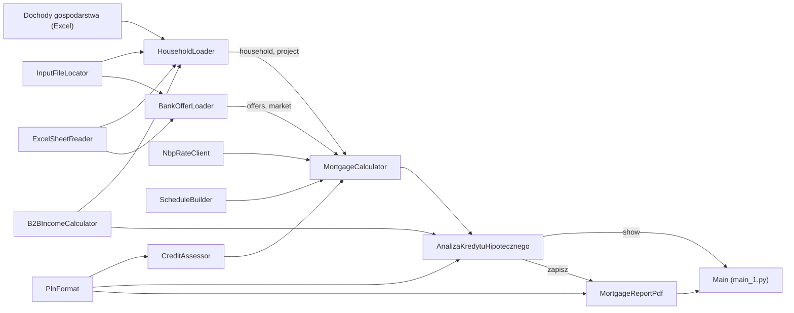

# Kredyt hipoteczny na budowę domu — analiza i porównanie banków

Interaktywna analiza kredytu hipotecznego na **budowę domu** w Polsce. Program wczytuje z Excela budżet
gospodarstwa domowego i plan budowy oraz oferty banków, a następnie pokazuje:

- ile trzeba pożyczyć, jaka będzie **rata**, **RRSO** i **całkowity koszt** kredytu,
- **porównanie banków** dla tego samego planu — od najtańszego,
- **ocenę zdolności kredytowej** według uproszczonych reguł Rekomendacji S KNF
  (rata testowa z buforem, DSTI, minimalne koszty życia, LTV),
- **budżet rodziny** w czasie budowy (odsetki od wypłaconych transz) i po przeprowadzce,
- **harmonogram spłat** z transzami, podwyżką marży do wpisu hipoteki i dopłatą za niski wkład,
- przeliczenie **dochodu z działalności (B2B)** z kwot faktur na dochód na rękę (ZUS, zdrowotna, PIT 2026).

Analizę można zapisać jednym kliknięciem jako raport **PDF**.

Projekt jest zbudowany w CatNip — wizualnym edytorze Pythona opartym na blokach. Każdy blok to jedna
klasa w osobnym pliku `.py` z własną stroną dokumentacji `.md`.

> [!WARNING]
> **To jest projekt poglądowy (edukacyjny), a nie porada finansowa, kredytowa ani inwestycyjna.**
> Gospodarstwa domowe w plikach przykładowych są **fikcyjne**. Marże, prowizje i warunki banków
> przepisano ręcznie z publicznych zestawień (bankier.pl, październik 2026) — mogą być nieaktualne,
> niepełne lub obarczone błędem i **nie są ofertą** żadnego banku. Ocena zdolności to uproszczenie
> reguł KNF; każdy bank liczy ją po swojemu. Stawki ZUS i podatków dotyczą 2026 r. i mogą się zmienić.
> Przed podjęciem decyzji poproś banki o wiążące oferty i harmonogramy, a w razie wątpliwości
> skonsultuj się z doradcą kredytowym lub podatkowym. Autor nie ponosi odpowiedzialności za decyzje
> podjęte na podstawie wyników programu.

## Co można zmieniać na stronie

Strona startuje z danymi z Excela i ofertą najtańszego banku. Ręcznie można zmienić m.in.: koszt
budowy, wartość działki, oszczędności, czas budowy i liczbę transz, bank, okres kredytu, rodzaj rat
(równe / malejące) i oprocentowania (zmienne / okresowo stałe), marżę, prowizję, dochody każdej osoby
i wydatki. Dla osoby rozliczającej się z faktur wystarczy wpisać kwotę **faktury netto** — dochód na
rękę przeliczy się sam. Kliknięcie wiersza w porównaniu banków przełącza analizę na ofertę tego banku,
a przyciski „Przywróć…” wracają do danych z plików.

## Jak liczy

- **Budowa:** kredyt jest wypłacany w transzach w równych odstępach; w czasie budowy płaci się tylko
  odsetki od wypłaconej kwoty. Potem spłata ratami równymi lub malejącymi.
- **Oprocentowanie miesiąca** = wskaźnik (WIBOR / POLSTR) + marża + podwyżka do wpisu hipoteki
  (pierwsze miesiące) + dopłata za niski wkład (dopóki saldo przekracza 80% wartości domu).
- **Wskaźniki** z pliku są przesuwane o zmianę **stopy referencyjnej NBP**, pobieranej przy starcie
  z darmowego pliku XML NBP. Bez internetu analiza działa na danych z pliku.
- **RRSO:** roczna stopa, przy której wypłacone transze równoważą prowizję, raty i ubezpieczenie.
- **Dochód B2B:** ryczałt, podatek liniowy albo skala; pełny ZUS, preferencyjny albo ulga na start.

## Dane wejściowe (`input/`)

| Plik | Zawartość |
|---|---|
| `dochody_rodziny.xlsx` | Przykładowa rodzina: dwoje dorosłych (umowa o pracę i B2B) i dwoje dzieci. |
| `dochody_singiel_b2b.xlsx` | Przykładowa osoba bez dzieci na B2B (74 zł/h netto, ok. 160 h miesięcznie). |
| `oferty_bankow.xlsx` | Oferty banków (arkusz **Oferty**) i reguły rynkowe (arkusz **Rynek**): wskaźniki, bufory KNF, limity DSTI, minimalne koszty życia, LTV. |

Plik gospodarstwa wybiera blok **Dochody gospodarstwa (Excel)** (domyślnie `input/dochody_singiel_b2b.xlsx`).
Musi mieć arkusze **Domownicy**, **Dochody**, **Wydatki** i **Inwestycja**; kolumna „Kwoty w arkuszu
Dochody” mówi, czy kwoty są **na rękę**, czy z **faktur**.

**Własne dane:** skopiuj jeden z plików przykładowych, wpisz swoje dochody, wydatki i plan budowy, i wskaż
go w bloku *Dochody gospodarstwa (Excel)*. **Nie publikuj pliku z prawdziwymi dochodami** — trzymaj go poza
repozytorium albo dopisz do `.gitignore`. Oferty banków aktualizuj w `oferty_bankow.xlsx` (kolumny są
rozpoznawane po nagłówkach, kolejność dowolna).

## Wymagania

- **Python 3.9 lub nowszy**.
- Pakiety z [`requirements.txt`](requirements.txt): `openpyxl` (odczyt Excela), `matplotlib` (wykresy i PDF).
- Internet — opcjonalnie, do pobrania aktualnej stopy referencyjnej NBP.
- **CatNip** — do wyświetlenia interaktywnej strony.

## Instalacja

```bash
git clone <adres-repozytorium>
cd KredytHipoteczny

python -m venv .venv
# Windows:
.venv\Scripts\activate
# Linux / macOS:
source .venv/bin/activate

pip install -r requirements.txt
```

## Uruchomienie

### W CatNip (zalecane)

1. Otwórz `KredytHipoteczny.catnip` w CatNip.
2. W bloku **Dochody gospodarstwa (Excel)** wskaż plik gospodarstwa.
3. Wybierz środowisko Pythona z zainstalowanymi pakietami (venv albo Docker) i uruchom przepływ (Run).
4. Strona pojawi się w zakładce **Output**. Przycisk **Zapisz PDF** tworzy nowy raport
   `output/kredyt_hipoteczny_<data_godzina>.pdf` przy każdym kliknięciu.

### Bez CatNip

```bash
python main_1.py
```

Dane zostaną wczytane i kalkulator zbudowany, ale interaktywną stronę (i zapis PDF) obsługuje tylko
Run Engine CatNip — poza nim zostanie wypisany jedynie komunikat, że strony nie ma gdzie pokazać.

## Struktura projektu



### Bloki, które wykonują pracę

| Blok | Do czego służy |
|---|---|
| `Dochody gospodarstwa (Excel)` | Wskazuje plik Excel gospodarstwa (blok File content). |
| `InputFileLocator` | Znajduje plik w folderze `input/` — lokalnie, w Dockerze (`/app`) i z folderu źródeł. |
| `ExcelSheetReader` | Czyta arkusze Excela (openpyxl). |
| `B2BIncomeCalculator` | Zamienia kwoty z faktur na dochód na rękę: koszty, ZUS, zdrowotna, PIT (ryczałt / liniowy / skala). |
| `HouseholdLoader` | Wczytuje domowników, dochody, wydatki i plan budowy. |
| `BankOfferLoader` | Wczytuje oferty banków i reguły rynkowe. |
| `NbpRateClient` | Pobiera bieżącą stopę referencyjną NBP; bez sieci zwraca brak danych. |
| `ScheduleBuilder` | Harmonogram kredytu budowlanego z transzami i RRSO. |
| `CreditAssessor` | Ocena zdolności kredytowej według uproszczonych reguł Rekomendacji S KNF. |
| `PlnFormat` | Kwoty i procenty po polsku. |
| `MortgageCalculator` | Łączy wszystko w jedno narzędzie: parametry domyślne, porównanie banków, harmonogram, ocena. |
| `AnalizaKredytuHipotecznego` | Interaktywna strona raportu z akcją **Zapisz PDF**. |
| `MortgageReportPdf` | Zapisuje analizę jako nowy plik PDF w `output/`. |
| `Main` | Punkt wejścia; z niego CatNip generuje `main_1.py`. |

### Rekordy danych (`@dataclass`)

| Blok | Co przechowuje |
|---|---|
| `HouseholdMember`, `ExpenseItem`, `HouseholdBudget`, `Household` | Domownicy, wydatki, miesięczny budżet i całe gospodarstwo. |
| `ConstructionProject` | Plan budowy: koszt, działka, oszczędności, rezerwa, okres, czas budowy, transze. |
| `BankOffer`, `NbpRate`, `MarketRates` | Oferta banku, stopa NBP, wskaźniki i reguły rynkowe. |
| `MortgageParameters` | Parametry kredytu ustawione na stronie. |
| `Installment`, `MortgageSchedule` | Rata i cały harmonogram z RRSO. |
| `CreditAssessment` | Wynik oceny zdolności kredytowej. |
| `TaxRules`, `BusinessTaxProfile`, `BusinessIncomeMonth` | Stawki ZUS i PIT na 2026 r., profil podatkowy domownika, miesiąc działalności. |
| `ExcelWorkbook` | Zawartość skoroszytu Excela. |
| `ReportTable`, `MortgageReportSnapshot` | Tabela raportu i stan strony przekazywany do zapisu PDF. |

Każdy blok ma swoją szczegółową dokumentację w pliku `<NazwaBloku>.md`.

### Pliki i foldery

| Ścieżka | Opis | W repozytorium |
|---|---|---|
| `KredytHipoteczny.catnip` | Projekt CatNip (graf bloków). | tak |
| `*.py`, `*.md` | Kod i dokumentacja bloków; `main_1.py` — wygenerowany punkt wejścia. | tak |
| `requirements.txt` | Zależności Pythona. | tak |
| `input/` | Przykładowe gospodarstwa i oferty banków. **Wymagane.** | tak |
| `output/` | Zapisane raporty PDF. | nie |

## Konfiguracja

- **Stawki podatkowe** (ZUS, składka zdrowotna, PIT) — wartości domyślne w `TaxRules.py` (2026 r.).
- **Oferty banków i reguły KNF** — `input/oferty_bankow.xlsx`, arkusze Oferty i Rynek.
- **Plik ofert** — parametr `file_name` bloku `BankOfferLoader` (domyślnie `oferty_bankow.xlsx`).
- **Folder raportów PDF** — parametr `output_dir` bloku `MortgageReportPdf` (domyślnie `output`).

## Licencja

Licencja nie została jeszcze wybrana — do czasu dodania pliku `LICENSE` wszystkie prawa zastrzeżone.

## Zastrzeżenie

Projekt ma charakter wyłącznie **poglądowy i edukacyjny**. Nie stanowi porady finansowej, kredytowej,
podatkowej ani inwestycyjnej, ani oferty w rozumieniu przepisów o kredycie hipotecznym. Wiążące warunki
kredytu podaje wyłącznie bank. Wszelkie decyzje podejmujesz na własną odpowiedzialność.
